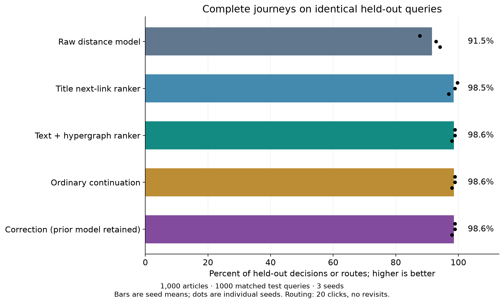

# WikiClick

## Goal
Find the optimal hyperlink path between two English Wikipedia articles. Live navigation resolves page URLs through the API, checks short paths, then uses fixed-parameter semantic vectors to guide best-first search. Returned links are observed in Wikipedia; global shortest-path optimality is not guaranteed.

[Deploy Locally](Deploy.md)<br>
[Mathematics Approach](Foundation%20of%20Models.md) <br>
[Timeline](TIMELINE.md)<br>
[AI contributions](AI_USAGE.md) <br>
[Figures](figures/README.md)

```bash
python3.13 -m venv .venv
.venv/bin/python -m pip install -r code/requirements.txt
.venv/bin/python code/run.py download-encoder
.venv/bin/python code/run.py live
```

Paste valid Wikipedia article URLs at the `Source:` and `Target:` prompts. The result shows a candidate shortest path, click count, and each page URL. See **Deploy** for a BFS demo without encoder weights, training commands, and exact download requirements.

````
Up to now, the algorithm fails if the fetching for next-link at every step exceeds 1,500; which exceeds the CPU capacity at every depth
````

## Layout

```text
training_data/training_data.json    consolidated recoverable supervision and provenance
figures/                           named curves, loss illustration, route charts, statistics
code/
  run.py                           command-line entry point
  requirements.txt                 tested local dependency versions
  wikiclick_core/
    API/                           live fetch, BFS, data collection/restoration
    model/
      neural/                      distance network and trainer
      title_feature/               SHA256 and frozen EmbeddingGemma features
      next_link/                   scoring, losses, negatives, residual ranker, trainer
      semantic/                    cosine, behavioral cloning, contextual rankers
      heuristic/                   BFS labels, offline corrections and random walks
      navigator/                   greedy, beam, best-first and saved-model inference
      evolutionary/                architecture search with a random-search control
```

The package sits beneath `code/` so it does not shadow Python's standard-library `code` module. Tests, original research drivers, experiments, checkpoints, caches, raw dumps and logs remain on the local device and are excluded from the next Git snapshot. They are not runtime dependencies of the public launcher. The public source is the maintained core; the local `codes/` tree preserves historical experiments and earlier interfaces.

## What each layer has achieved

| Layer | Evidence | Limit |
|---|---|---|
| API + BFS | Canonical article IDs, redirect handling, unit-cost directed edges; BFS gives a shortest route in the saved graph | A sampled graph can omit shorter Wikipedia routes |
| Neural distance | Smooth L1 regression on BFS-derived distances; SHA256/EmbeddingGemma title comparison | Hash vectors do not encode meaning; smaller MAE alone does not establish better routing |
| Next-link ranking | On the recorded 1,000-node graph, title ranker reached 98.50% of test goals vs raw 91.53%; shortest-route rates 66.17% vs 51.17% | Different training stages; these are graph-relative held-out results, not live-web guarantees |
| Semantic/context | Original text/category ranker reached 98.57% and shortest routes 68.13% on that graph; later pretrained/context experiments remain separate | Original context features were hashes/category pooling, not EmbeddingGemma; no clear completion gain over title ranking |
| Heuristic correction | Training-only hard-example resampling and validation rollback are implemented | Correction retained the earlier checkpoint for all three small-graph seeds; no demonstrated improvement; no live weight updates |
| Navigation | Greedy, beam and best-first; live URL input, API edge checks and two-link probes work | Live success and shortest-path frequency have not been systematically benchmarked |
| Evolution | Architecture mutation, selection and equal-size random control; 99/100 goals reached by baseline/evolution/random in the pilot | Shortest routes were 76/75/74; evolution did not establish superiority |
| Offline random walks | Saved RFBC and later scaling training corpora are included in the JSON; sampler and policy primitives are public | Offline work is not an integrated live-fetch acceleration model; later experiment drivers stay local |

Figures **LC02**, **LC03**, **NV01–NV04**, **EV01–EV02**, and **RW01–RW02** are indexed with their dataset and model in the [catalogue](figures/README.md). [Recorded small-graph statistics](figures/statistics/next_link_1000.json) accompany the percentages above. Million-node results are a separate benchmark and must not be used as live-navigation accuracy.



## Drawbacks and next steps

Live search can fan out to thousands of candidates. API pagination, two-hop checks and introduction downloads run sequentially; frozen embeddings are computed on the CPU. **Network fetching is not CPU inference**: CPU encoding is the expensive local stage. In the inspected FC Barcelona query, 1,047 outgoing articles were fetched in five queries in about 0.9 seconds, before up to 21 bridge checks, 53 introduction batches and candidate encoding. That single measurement is not a latency benchmark.

Caches currently last for one live run. The current CPU setup, repeated article encoding, large outgoing-link sets, and query budgets can make longer searches slow or unsuccessful. Default live scoring is semantic cosine **M0**, not the graph-specific corrected next-link checkpoint. Compatible M1/M2 checkpoints are optional local inputs.

Future work: persistent caches; visible phase/timing progress; cheap candidate preselection before expensive text encoding; and adapting the existing offline random-walk policy to guide live fetch decisions. These changes must be tested for latency, success and route-length tradeoffs on unseen endpoint pairs. We do not yet claim “usually shortest,” independent full-Wikipedia generalization, online self-learning, or successful live random-walk deployment.

The single JSON contains recoverable source training corpora, explicit validation/test partitions, numerical index mappings and selection evidence. It does not imply every graph article or every available row received an optimizer update. Exact historical minibatch replay and full million-node graph restoration remain limited by saved artifacts; see [data coverage](training_data/README.md).
