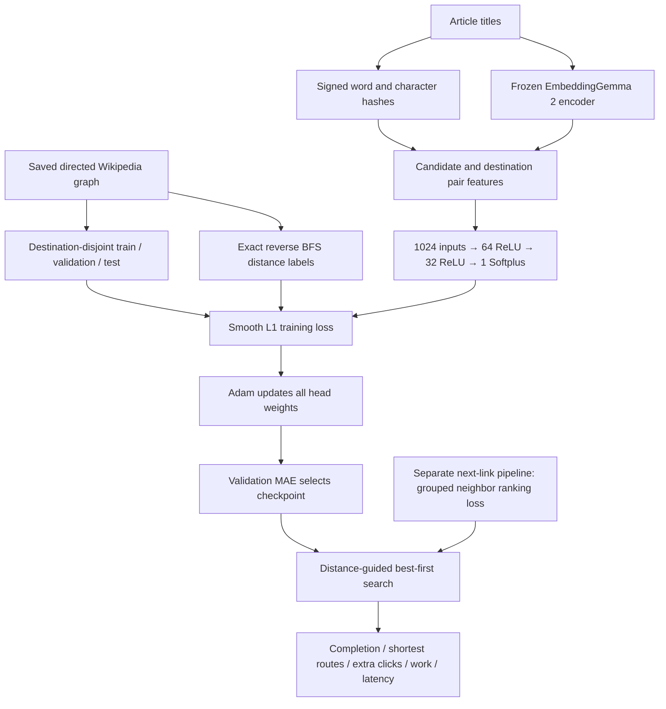

# Model structure, current evidence, and next experiments

Inspected November 12, 2026. This is a review and proposed experiment plan, not a new training result. The user's current changes to `ml_model.py` and `train_model.py` were preserved. Existing tests: 55 passed.

## Current structure

The diagram's 1024 input width applies to the new 256-dimensional feature experiment. Candidate vector `c` and destination vector `d` form `[c, d, abs(c-d), c*d]`, giving `4 × 256` inputs. Legacy rankers use 128-dimensional inputs and therefore 512 pair features.

| Component | Active implementation | Responsibility |
|---|---|---|
| Feature/model definition | [ml_model.py](../../codes/models/raw/ml_model.py) | Hashing, optional frozen title encoder, pair features, distance head |
| Distance training and feature comparison | [train_model.py](../../codes/models/raw/train_model.py) | Graph/split validation, deduplicated pairs, batches, updates, checkpoint selection, evaluation |
| Search reference and comparator | [compare_search.py](../../codes/search/compare_search.py) | BFS or distance-guided greedy best-first; learned scores do not guarantee optimality |
| Next-link training | [next_link_experiment.py](../../codes/models/next_link/next_link_experiment.py) | Group outgoing neighbors, score optimal choices, train ranking and correction variants |
| User-facing navigation | [rank_navigate.py](../../codes/models/next_link/rank_navigate.py) | Existing small-graph rankers and saved features |
| New comparison evidence | [comparison.json](../../models/raw/title_feature_comparison/comparison.json) | Three seeds, matched SHA256/semantic arms on separate 100- and 1,000-article tasks |

**64 and 32 are numbers of hidden units, not bits.** Each `Linear` layer is affine, but its following ReLU makes the overall head nonlinear; Softplus is also nonlinear. At 256 feature dimensions the head has 67,713 trainable parameters. Adam already updates the weights and biases of both hidden layers through backpropagation. It does not automatically change their widths or number. The semantic encoder is a pretrained Transformer used as a frozen feature extractor; it is not a newly trained Transformer navigation policy. [ReLU documentation](https://docs.pytorch.org/docs/2.11/generated/torch.nn.ReLU.html), [encoder model card](https://huggingface.co/google/embeddinggemma-2).

The new semantic comparison updates the distance-regression branch. It has not automatically replaced the title features of the separate next-link ranker. `Ranker` still constructs a default 128-dimensional `DistanceModel`, and the old comparison CLI accepts only the original feature version. The new trainer's custom `route_results` supports its semantic vectors, but a general inference loader must explicitly support feature method, dimensions, encoder revision, and vector cache before these checkpoints can become interchangeable deployment options.

## What we have actually measured

The new comparison fixes dimensions at 256, head widths at 64/32, Adam learning rate at 0.001, batch size at 256, and training budget at 25 epochs. Within each seed, the two feature arms have matching pair hashes, initialization hashes, and batch order.

| Saved graph | SHA256 test MAE | Semantic test MAE | Relative MAE reduction |
|---|---:|---:|---:|
| 100 articles | 0.5238 | 0.4274 | 18.41% |
| 1,000 articles | 0.4320 | 0.4102 | 5.04% |

These are three-seed means, not independent graph replications or proof of a scaling law. Graph sizes have different graph-relative labels and partitions. On the 1,000-article graph:

| Quantity | SHA256 | Semantic |
|---|---:|---:|
| Selected epochs, seeds 207/208/209 | 11 / 10 / 9 | 23 / 24 / 25 |
| Mean best validation MAE | 0.4465 | 0.4439 |
| Mean final-epoch validation MAE | 0.4803 | 0.4473 |
| Test goal completion, seed mean | 99.67% | 99.00% |
| Test shortest-route rate, seed mean | 69.00% | 72.33% |
| Mean nodes expanded, seed mean | 10.57 | 14.27 |

Semantic features improve distance MAE and shortest-route rate here, but completion and expansion count do not improve. The comparison uses a 200-expansion best-first search, not the earlier 20-click next-link navigation experiment; do not merge their percentages into one table.

The new 1,000-article distance experiment also derives pairs by sampling all reachable article/destination combinations when raw JSONL is absent. The earlier ranking experiment's raw baseline used candidate/destination pairs derived from sampled neighbor decisions. The feature comparison is controlled within its own experiment; it is not an isolated comparison with those historical raw-model results.

See [the recorded learning curves](../../figures/raw/title_feature_comparison/learning_curves_1000.png). Training loss is already smooth and descending. Hashed-feature validation error reaches its minimum near epoch 10 and then rises. This is consistent with overfitting, rather than evidence of an exploding or unstable optimizer. Semantic validation remains near its minimum much later. One semantic run selects the last permitted epoch, so its convergence horizon is not established.

The plotted training metric is Smooth L1, whereas the validation metric is MAE. Their numeric difference is **not** a train/validation generalization gap. Log both metrics on both partitions under the same evaluation procedure before quantifying that gap.

## The five proposed improvement areas

### 1. Title features: keep the controlled improvement; fix provenance and task alignment

The semantic-versus-hashing comparison is a useful controlled experiment. Next, cache the actual title-vector matrix with page-ID order, normalization, dimensions, prompt, encoder commit, and a content hash. The saved comparison records `encoder_revision: null`; this leaves the model revision insufficiently identified. Pin the revision and semantic dependency versions. The repository's original requirements do not explicitly capture the new semantic stack.

Then compare title-only features with title plus a short cached introduction. Keep head size, examples, and training procedure fixed. The encoder's semantic similarity is useful information, but Wikipedia navigation depends on directed links, so semantic closeness need not mean fewer clicks. Consider cheap degree/link-context features as a separate later ablation; never use exact held-out distances as inputs.

Most importantly, integrate the winning representation into the existing grouped next-link objective before assuming a lower distance MAE means a better next-link policy. That is a separate experiment, not something the current feature comparison already proves.

### 2. Best epoch: already implemented; add stopping and an explicit selection target

`fit_model` evaluates validation MAE after every epoch, copies the best weights, and restores them. Test labels are loaded afterward. This is already the correct separation for a distance-prediction experiment.

What is missing is early stopping, a learning-rate schedule, and consistent diagnostics. For distance regression, retain validation MAE selection. For a navigation-focused experiment, predeclare a selection rule using validation neighbor-ranking quality and/or fixed-budget validation journeys, then open the test once. Do not choose the rule by whichever existing test result looks best.

For fine-tuning an existing checkpoint, include epoch 0 as a candidate, as the next-link trainer already does. That protects against making a working model worse. For fresh training, an untrained epoch-0 measurement is mainly a useful reference.

### 3. Hidden layers: separate weight updates from architecture changes

The existing nonlinear head is not demonstrably too small: the hashed arm continues reducing training loss while validation worsens. Adding layers could increase memorization. First test regularization and optimizer control.

After fixing the evaluation protocol, compare a small predefined set such as `[32]`, existing `[64,32]`, and `[128,64]`. Keep ReLU fixed initially. Test a different activation, a deeper head, or dropout only in later isolated comparisons. A linear head is also a useful capacity baseline. Save complete architecture configuration and support old checkpoints when changing construction; the second hidden width is currently hard-coded at 32.

### 4. Epoch budget: measure optimizer updates and convergence, not article count

At batch size 256, 7,446 pairs mean 30 updates per epoch, whereas 30,000 pairs mean 118. Twenty-five epochs therefore mean 750 versus 2,950 updates. The current 1,000-article capped training set covers 800 destinations, not 30,000 independent navigation tasks.

Use a generous maximum plus validation-based stopping. Log epoch, optimizer step, number of unique pairs/destinations seen, and elapsed time. More data does not imply a universal proportional increase in epochs. For sample-size studies, use nested pair subsets and compare both epoch-based and compute-based learning curves.

For the next controlled optimizer comparison, a **proposed starting configuration** is a 50-epoch cap, validation plateau LR reduction by 0.5 after 3 stalled epochs, minimum LR 1e-5, and early-stop patience of 8 epochs with a declared 0.001-click meaningful-improvement threshold. These are hypotheses to validate, not measured optimal settings. Save the actual lowest-MAE checkpoint even if a smaller improvement does not reset the stopping counter. Step the scheduler once after validation. [PyTorch ReduceLROnPlateau](https://docs.pytorch.org/docs/2.11/generated/torch.optim.lr_scheduler.ReduceLROnPlateau.html).

### 5. Splits and sampling: improve the experiment, not the appearance of the curve

Keep destinations grouped. A random row split would let highly related examples for the same destination cross partitions. The current destination split is a sound baseline, but remains transductive on one shared graph. For unfamiliar topics or future graph snapshots, add a separate topic/graph/time holdout stress test. Do not remove test articles from the graph when the intended claim is shared-graph destination generalization. [Grouped validation guidance](https://scikit-learn.org/stable/modules/cross_validation.html#cross-validation-iterators-for-grouped-data).

Separate `data_seed` from initialization/batch `model_seed`. Currently the same seed controls pair subsampling and model initialization. On the capped 1,000-article task this changes example membership across seeds, so the shaded band mixes initialization and sampling variation. Within each seed the two feature arms are still matched. The 100-article task uses all available pairs; its seed changes ordering rather than membership.

For the first optimizer comparison, freeze identical train/validation pair identities across all model seeds. Use destination-level repeated folds on development destinations to assess split sensitivity; keep a final evaluation partition separate. Existing test destinations have already informed our discussion, so call subsequent results development evidence unless a new final holdout is set aside.

Audit destination counts, graph degree, topic mix, and distance distributions. In the current seed-207, 30,000-pair training sample, labels are `{0:27, 1:1621, 2:15526, 3:11757, 4:988, 5:75, 6:6}`: **90.94% are distance 2 or 3**. All 800 training destinations are represented, but rare longer-distance behavior has little supervision. Report MAE by distance bucket and per-destination mean. Test goal-balanced or distance-aware training sampling as an explicit ablation, leaving evaluation queries fixed.

Add a train-median constant baseline for MAE, alongside the existing train-mean baseline. A read-only audit on the current three sampled test sets gives mean median-baseline MAE 0.4889, compared with the recorded mean-baseline 0.5695; both neural feature arms still beat it. This is a post-hoc diagnostic, not new model selection or a new training run.

## Recommended order of work

1. **Lock measurement and reproducibility.** Cache/version features; separate data/model seeds; freeze development examples; add common train/validation metrics, update counts, LR, and per-destination/distance summaries. Record model/feature configuration for loading.
2. **Run one optimizer ablation on the 1,000-article development task.** Keep semantic title vectors, `[64,32]`, 30,000 pairs, batch 256, and three model seeds fixed. Compare constant-LR Adam with plateau-LR Adam using the same maximum/stopping protocol and example identities. Do not simultaneously change widths, splits, and sampling. A separately reported historical 25-epoch reference is useful but not a matched stopping-budget control.
3. **Test regularization if the common-metric gap persists.** For example, an isolated AdamW weight-decay ablation, followed by the small width comparison. No claim that AdamW or deeper layers must win. [AdamW documentation](https://docs.pytorch.org/docs/2.11/generated/torch.optim.AdamW.html).
4. **Connect features to the actual navigation objective.** Make the next-link head dimension-aware, train it with the same cached semantic titles and existing grouped optimal-neighbor labels, and compare against matched semantic distance regression. Measure valid-link ranking, completion, shortest routes, excess clicks, work, and end-to-end cost.
5. **Only then expand coverage or architecture search.** Evaluate split/topic sensitivity and long-distance coverage before another NAS run or million-scale sweep. Declare the final selection rule and held-out evaluation before training finalists.

The immediate focus is **fixed evaluation + optimizer/early-stopping diagnostics**, not making a line cosmetically smooth or adding layers by default. Success means reproducibly lower held-out error and/or better routes under the declared budget. Keep unsmoothed per-seed curves visible; any moving average should be labeled and never used to select a checkpoint.

## Corrections to the training notes

The user's [function notes](../guides/train_model.md) are a useful reading aid, with a few distinctions: `goals` describes destination partitions, not connected components; `load_split` loads an existing split rather than assigning it; `train_one_epoch` returns a scalar loss and mutates model/optimizer state; Adam is an optimizer with update state, not the gradients themselves; `evaluate_and_save` evaluates and saves the already selected model and does not train it again.
